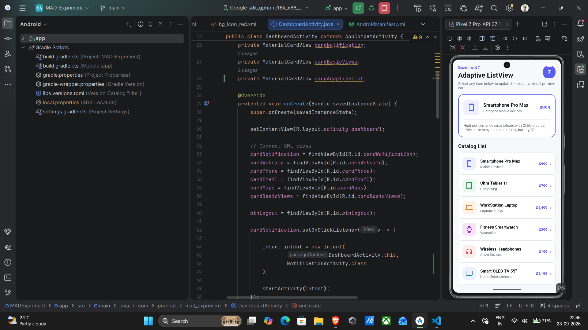
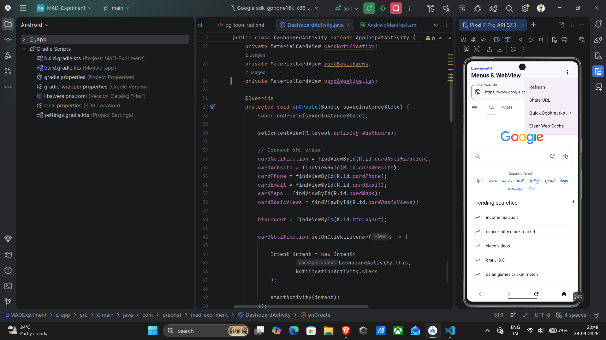
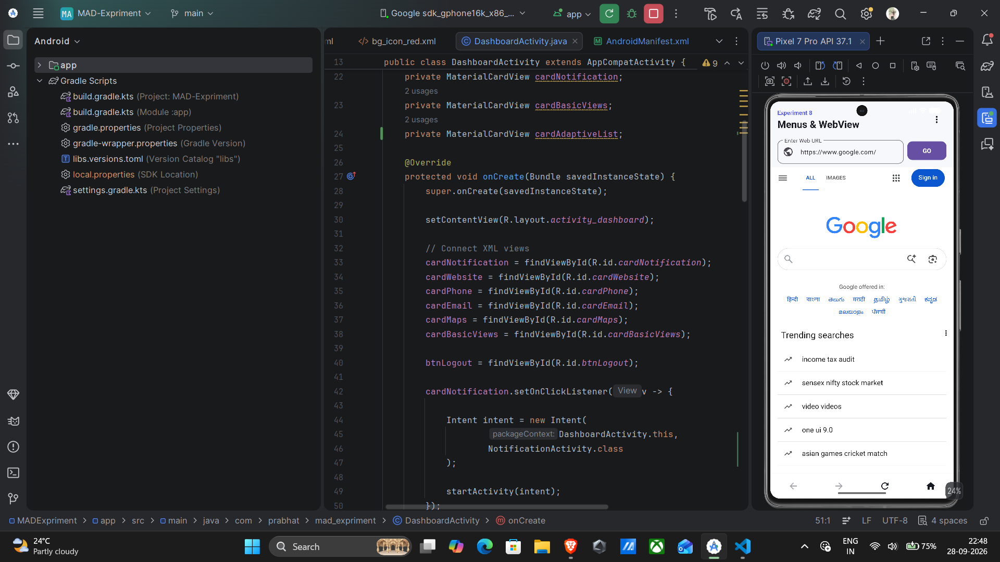

## Student Details

| | |
|---|---|
| **Name** | Prabhat Kumar |
| **USN** | 25MCAR0110 |
| **Class** | MCA (General) |

## Technologies

- Android Studio
- Java
- XML
- Android SDK
- Material Components

## Experiments

### Experiment 4 — Linking Activities Using Intents

Implemented:

- Login Activity
- Signup Activity
- Dashboard Activity
- Explicit Intent for Activity navigation
- Implicit Intent for:
   - Website
   - Phone Dialer
   - Email
   - Maps

#### Screenshot


---

### Experiment 5 — Android Notification

Implemented:

- Notification Channel
- Notification permission
- Android notification
- Heads-up / pop-up notification
- Notification panel notification

#### Screenshot


---

### Experiment 6 — Android Basic Views

Implemented:

- TextView
- Radio
- Button


#### Screenshot


---

### Experiment 7 — Adaptive UI (ListView and ImageView)

Implemented:

- Custom `ArrayAdapter` (`AdaptiveListAdapter`) for `ListView`
- Custom row item layout (`list_item_adaptive.xml`) with `ImageView` and `TextView`s
- Adaptive detail preview card updating dynamically on list item selection
- Interactive item selection handling and Toast notifications
---

#### Screenshot


---

### Experiment 8 — Menus and WebView

Implemented:

- Android Options Menu (`res/menu/menu_web_view.xml`) & Popup/Context Menu
- Integrated `WebView` with JavaScript enabled and zoom controls
- In-app URL navigation handling using `WebViewClient` and `WebChromeClient`
- Interactive URL address bar, search action, and horizontal progress bar
- Bottom navigation bar controls (Back, Forward, Refresh, Home)
- System Back Press dispatcher handling for WebView navigation history
---

#### Screenshot



---

## Project Structure

```text
AndroidExperiments
├── app
├── screenshots
│   ├── exp4-intent.png
│   └── exp5-notification.png
├── build.gradle.kts
├── settings.gradle.kts
└── README.md