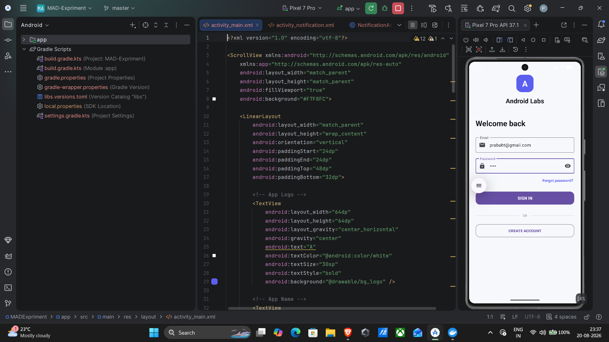
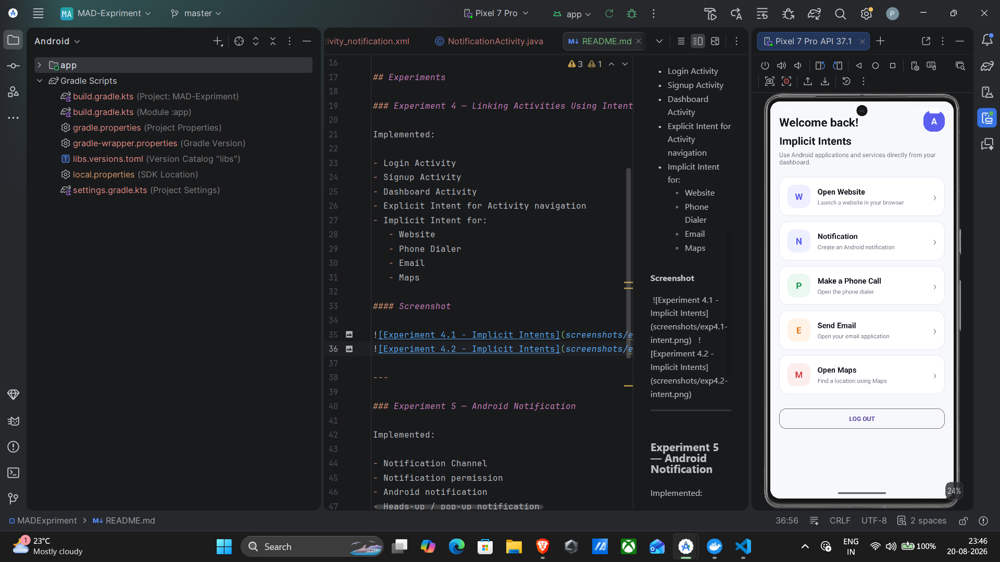
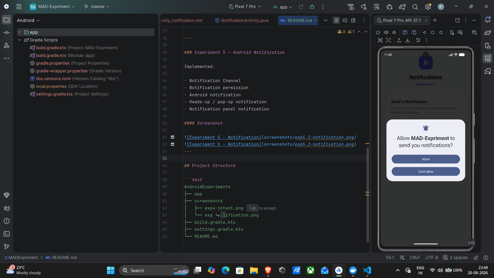
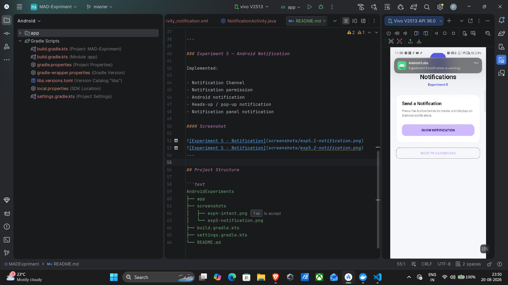
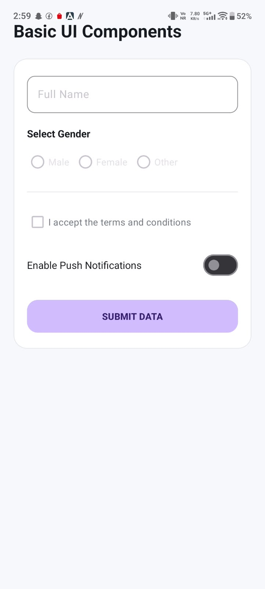
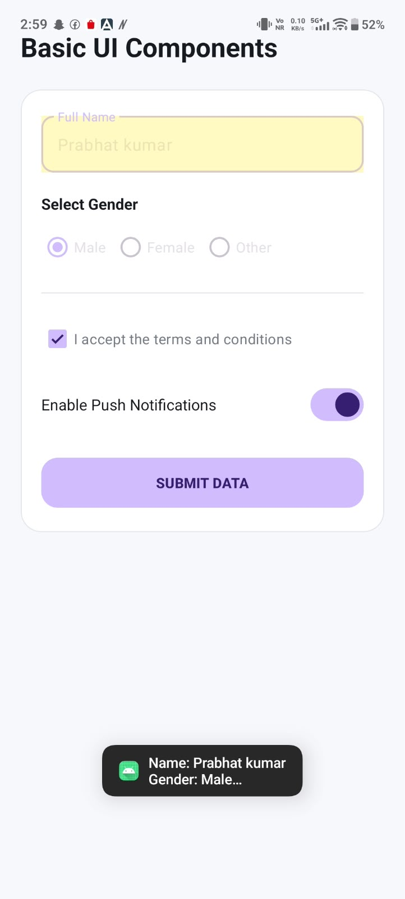

## Student Details

| | |
|---|---|
| **Name** | Prabhat Kumar |
| **USN** | 25MCAR0110 |
| **Class** | MCA (General) |

## Technologies

- Android Studio
- Java
- XML
- Android SDK
- Material Components

## Experiments

### Experiment 4 — Linking Activities Using Intents

Implemented:

- Login Activity
- Signup Activity
- Dashboard Activity
- Explicit Intent for Activity navigation
- Implicit Intent for:
   - Website
   - Phone Dialer
   - Email
   - Maps

#### Screenshot




---

### Experiment 5 — Android Notification

Implemented:

- Notification Channel
- Notification permission
- Android notification
- Heads-up / pop-up notification
- Notification panel notification

#### Screenshot



---

### Experiment 6 — Android Basic Views

Implemented:

- TextView
- Radio
- Button


#### Screenshot



---
## Project Structure

```text
AndroidExperiments
├── app
├── screenshots
│   ├── exp4-intent.png
│   └── exp5-notification.png
├── build.gradle.kts
├── settings.gradle.kts
└── README.md