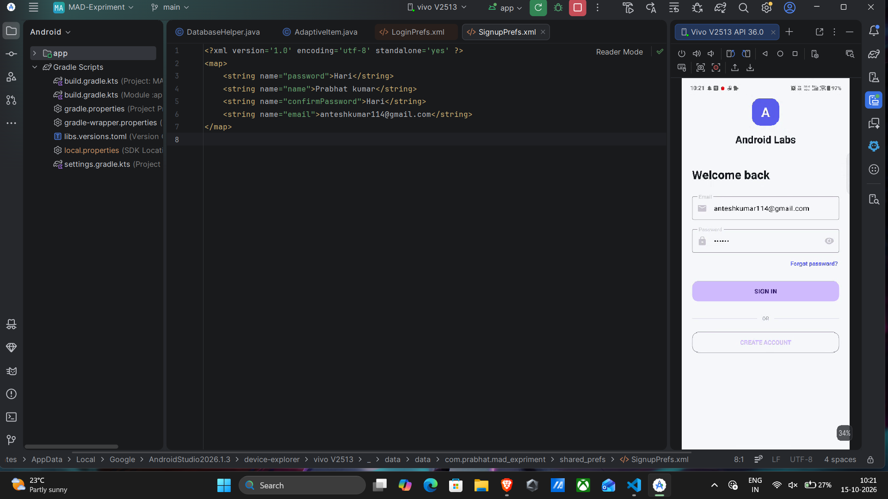
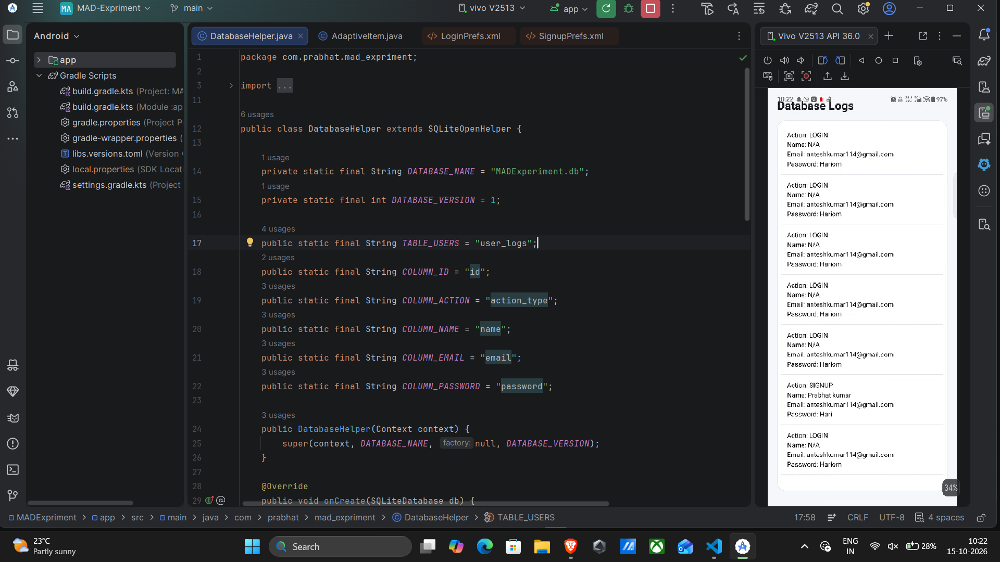
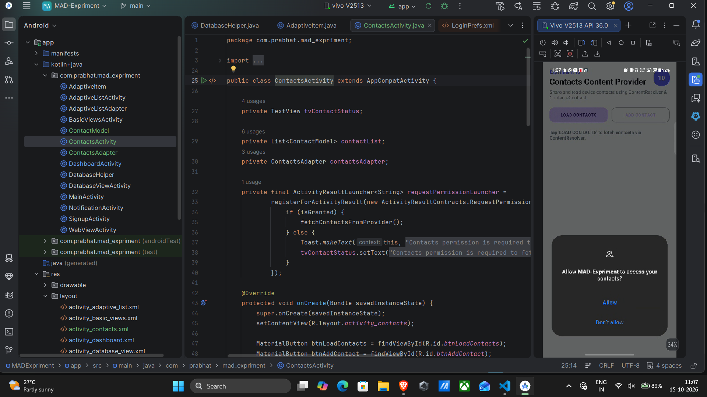
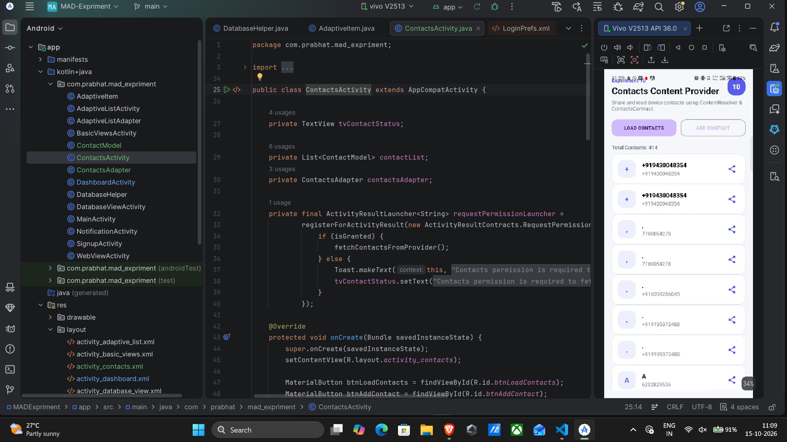

## Student Details

| | |
|---|---|
| **Name** | Prabhat Kumar |
| **USN** | 25MCAR0110 |
| **Class** | MCA (General) |

## Technologies

- Android Studio
- Java
- XML
- Android SDK
- Material Components

## Experiments

### Experiment 4 — Linking Activities Using Intents

Implemented:

- Login Activity
- Signup Activity
- Dashboard Activity
- Explicit Intent for Activity navigation
- Implicit Intent for:
   - Website
   - Phone Dialer
   - Email
   - Maps

#### Screenshot


---

### Experiment 5 — Android Notification

Implemented:

- Notification Channel
- Notification permission
- Android notification
- Heads-up / pop-up notification
- Notification panel notification

#### Screenshot


---

### Experiment 6 — Android Basic Views

Implemented:

- TextView
- Radio
- Button
- CheckBox
- Switch

#### Screenshot


---

### Experiment 7 — Adaptive UI (ListView and ImageView)

Implemented:

- Custom `ArrayAdapter` (`AdaptiveListAdapter`) for `ListView`
- Custom row item layout (`list_item_adaptive.xml`) with `ImageView` and `TextView`s
- Adaptive detail preview card updating dynamically on list item selection
- Interactive item selection handling and Toast notifications

#### Screenshot


---

### Experiment 8 — Menus and WebView

Implemented:

- Android Options Menu (`res/menu/menu_web_view.xml`) & Popup/Context Menu
- Integrated `WebView` with JavaScript enabled and zoom controls
- In-app URL navigation handling using `WebViewClient` and `WebChromeClient`
- Interactive URL address bar, search action, and horizontal progress bar
- Bottom navigation bar controls (Back, Forward, Refresh, Home)
- System Back Press dispatcher handling for WebView navigation history

#### Screenshot


---

### Experiment 9 — Data Persistence (SharedPreferences & SQLite)

Implemented:

- Automatic input field persistence across app restarts using `SharedPreferences` in `MainActivity` and `SignupActivity`
- Restored input field text rendering in solid black font (`#000000`) across all input screens
- Local SQLite database management (`DatabaseHelper`) storing user login and signup records
- Dedicated `DatabaseViewActivity` with custom list row styling (`list_item_log.xml`) to display recorded database entries
- Automated redirection to `DashboardActivity` following successful user authentication or signup

#### Screenshot




---

### Experiment 10 — Content Provider (Contacts & Data Sharing)

Implemented:

- Android Contacts Content Provider integration via `ContentResolver` & `ContactsContract.CommonDataKinds.Phone`
- Runtime permission dispatcher for `READ_CONTACTS` (`Manifest.permission.READ_CONTACTS`)
- Custom list presentation (`ContactsAdapter` & `list_item_contact.xml`) displaying contact avatar initials, names, and phone numbers
- Data Sharing capability allowing individual contacts to be shared via `Intent.ACTION_SEND`
- Insert action triggering `Intent.ACTION_INSERT` for `ContactsContract.Contacts.CONTENT_URI` to add contacts via system UI

#### Screenshot




---

### Experiment 11 — Google Maps Application

Implemented:

- Integrated Google Maps Android SDK (`com.google.android.gms:play-services-maps`) via `SupportMapFragment`
- Location Search Bar with Geocoding support (`Geocoder`) to search any city/place name and animate camera to target
- Landmark Preset Chips for instant navigation (Bengaluru, New Delhi, Taj Mahal, Silicon Institute, Mumbai)
- Map View Type Selectors allowing switching between Normal, Satellite, Terrain, and Hybrid views
- Custom interactive controls: Zoom In (`+`), Zoom Out (`-`), and Clear Markers
- Runtime location permission handling (`ACCESS_FINE_LOCATION`, `ACCESS_COARSE_LOCATION`) for My Location positioning
- Interactive Map Tap event listener to place custom location pins and display coordinates
- Implicit Intent launcher for opening external Google Maps app (`geo:` URI / web fallback)

---

### Experiment 12 — Access Web Services Using HTTP Requests (Tech News & Knowledge)

Implemented:

- Live Tech News & Knowledge Web Service fetching real-time articles via REST API endpoints (`https://dev.to/api/articles`)
- Topic Filter Selectors for instant query filtering:
   - **Latest Tech News**
   - **Android & Mobile Tech** (`tag=android`)
   - **AI & Innovation** (`tag=ai`)
   - **REST Mock API** (`jsonplaceholder.typicode.com/posts`)
- Asynchronous HTTP communication using native Java `HttpURLConnection`, `ExecutorService`, and `Handler(Looper.getMainLooper())`
- Enhanced Article Item presentation (`PostAdapter` & `list_item_post.xml`) displaying category badges, titles, descriptions, authors, reading time, and direct article browser links
- HTTP POST Request implementation allowing publishing/creating knowledge articles with JSON payload (`{"title": "...", "body": "...", "userId": 1}`)
- Real-time HTTP Response Status Log displaying HTTP status codes (`200 OK`, `201 Created`), request latency in `ms`, and returned JSON response payloads
- Fallback curated Tech Knowledge engine ensuring content availability under network constraint conditions

---

## Project Structure

```text
AndroidExperiments
├── app
│   └── src
│       └── main
│           ├── AndroidManifest.xml
│           ├── java/com/prabhat/mad_expriment/
│           │   ├── AdaptiveItem.java
│           │   ├── AdaptiveListActivity.java
│           │   ├── AdaptiveListAdapter.java
│           │   ├── BasicViewsActivity.java
│           │   ├── ContactModel.java
│           │   ├── ContactsActivity.java
│           │   ├── ContactsAdapter.java
│           │   ├── DashboardActivity.java
│           │   ├── DatabaseHelper.java
│           │   ├── DatabaseViewActivity.java
│           │   ├── MainActivity.java
│           │   ├── MapsActivity.java
│           │   ├── NotificationActivity.java
│           │   ├── PostAdapter.java
│           │   ├── PostModel.java
│           │   ├── SignupActivity.java
│           │   ├── WebServiceActivity.java
│           │   └── WebViewActivity.java
│           └── res/
│               ├── layout/
│               │   ├── activity_adaptive_list.xml
│               │   ├── activity_basic_views.xml
│               │   ├── activity_contacts.xml
│               │   ├── activity_dashboard.xml
│               │   ├── activity_database_view.xml
│               │   ├── activity_main.xml
│               │   ├── activity_maps.xml
│               │   ├── activity_notification.xml
│               │   ├── activity_signup.xml
│               │   ├── activity_web_service.xml
│               │   ├── activity_web_view.xml
│               │   ├── list_item_adaptive.xml
│               │   ├── list_item_contact.xml
│               │   ├── list_item_log.xml
│               │   └── list_item_post.xml
│               └── menu/
│                   └── menu_web_view.xml
├── screenshots/
├── build.gradle.kts
├── settings.gradle.kts
└── README.md
```
